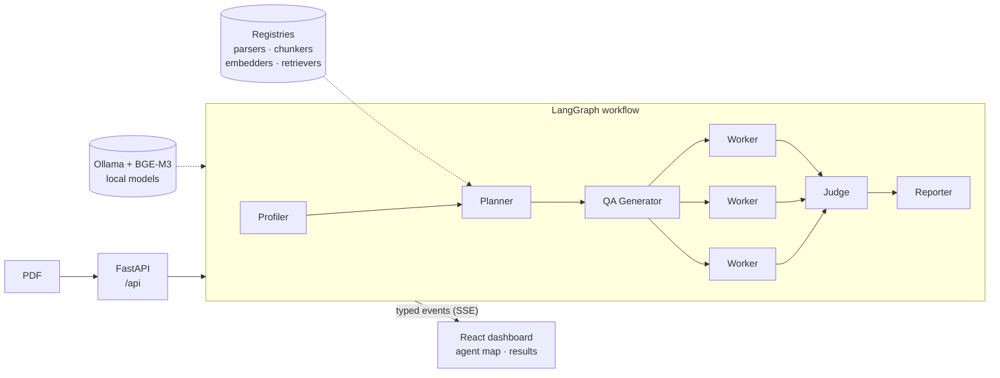

<div align="center">

# RAG Hive

**Find the best RAG pipeline for your PDF. A hive of agents benchmarks them while you watch.**

[](https://github.com/enzo-thuilliez/rag-hive/actions/workflows/ci.yml)
[](https://github.com/enzo-thuilliez/rag-hive/releases)
[](LICENSE)


[Why](#why) · [How it fits together](#how-it-fits-together) · [What it does](#what-it-does) · [Quick start](#quick-start) · [Stack](#stack) · [Corpus](#corpus) · [Roadmap](ROADMAP.md)

</div>

> **Status:** scaffolding and corpus done; the golden set is next. Every module exists as a typed
> stub; no parser, chunker, embedder, retriever or agent logic runs yet. See [ROADMAP.md](ROADMAP.md).

## Why

Whether a RAG system answers well depends on four choices: how the PDF is parsed, how it is
chunked, how chunks are embedded and how they are retrieved. The best combination changes from
one document to the next, and trying them by hand is slow. RAG Hive takes a PDF, generates
questions about it, runs every candidate pipeline in parallel, scores them and shows the
results in a dashboard. A live map lets you watch the agents do the work. Everything runs
locally: no paid API at runtime.

## How it fits together



1. Pipeline components implement small async interfaces and register by name, so the Planner
   can build any combination from a config.
2. Each agent emits typed events (`agent_started`, `tool_call`, `progress`, `result`,
   `handoff`, `error`), streamed over SSE with resume support.
3. The dashboard draws the workflow from `/api/runs/{id}/graph` and animates it from the event
   stream. The backend serves only `/api`; every other path belongs to the frontend.

More in [docs/architecture.md](docs/architecture.md) and [AGENTS.md](AGENTS.md).

## What it does

- **Profile the document.** Detect what the PDF holds (tables, images, layout, length) to pick
  sensible candidates.
- **Plan the grid.** Choose parsing × chunking × embedding × retrieval configs to compare.
- **Generate questions.** Build a QA set grounded in the document, with source pages.
- **Benchmark in parallel.** One worker per pipeline config indexes the PDF and answers the QA set.
- **Judge and report.** Score retrieval and answers with evaluation code, then rank the pipelines.
- **Watch it live.** Agents stream typed events to an agent map and a results dashboard.

## Quick start

Requires Python 3.12 with [`uv`](https://docs.astral.sh/uv/), Node 24 with pnpm (via
corepack), and `make`.

```sh
git clone https://github.com/enzo-thuilliez/rag-hive.git && cd rag-hive
cp .env.example .env   # local defaults, no API keys
make install           # uv sync, pnpm install, git hooks
make dev               # backend on :8000 + frontend on :5173
make corpus            # download and verify the benchmark PDFs
```

`make help` lists every target. Contributing: [CONTRIBUTING.md](CONTRIBUTING.md).

## Stack

| Layer | Tech |
| --- | --- |
| API | Python 3.12, [FastAPI](https://fastapi.tiangolo.com/), pydantic-settings, [`uv`](https://docs.astral.sh/uv/) |
| Agents | [LangGraph](https://github.com/langchain-ai/langgraph), [Ollama](https://ollama.com/) (Qwen), local only |
| Embeddings | [BGE-M3](https://huggingface.co/BAAI/bge-m3) via [sentence-transformers](https://sbert.net/), local only |
| Dashboard | React, TypeScript, Vite, Tailwind, [React Flow](https://reactflow.dev/), [Recharts](https://recharts.org/) |
| Quality | ruff, mypy `--strict`, pytest, typescript-eslint (type-aware), Prettier, Vitest, pre-commit |

## Corpus

The benchmark runs on 10 PDFs listed in [`data/corpus/manifest.yaml`](data/corpus/manifest.yaml),
each pinned to an exact version by URL and SHA-256. **The PDFs are never committed**: we have no
right to redistribute them. `make corpus` downloads them to `data/corpus/raw/` (gitignored),
refuses any file whose checksum differs from the manifest, and skips files already present.
A few sources sit behind a disclaimer or block automated downloads; for those, `make corpus`
prints where to download the file by hand and where to save it, then verifies it on the next
run. It also generates derived files, such as an image-only copy of the scanned 1920 report
with no text layer, into `data/corpus/derived/` (gitignored too).

## Repository layout

```text
backend/     FastAPI app, LangGraph agents, pipeline components (Python, uv)
frontend/    React dashboard (Vite, pnpm)
docs/        architecture notes, generated data schemas
data/        corpus manifest; local PDFs and results (gitignored)
```

## Development

The rules for humans and coding agents are the same: [AGENTS.md](AGENTS.md) holds the agent
and event contract plus the issue → branch → PR workflow, [DECISIONS.md](DECISIONS.md) the
ADRs, [ROADMAP.md](ROADMAP.md) the plan.

```sh
make lint        # ruff, eslint, prettier
make typecheck   # mypy --strict, tsc
make test        # pytest, vitest
```

## License

[MIT](LICENSE)
